# Giliran

Giliran is a transparent arisan (rotating savings group) manager. An organizer runs a group of members who each pay a fixed share every period. The app records who paid, draws the period's winner with a verifiable commit-reveal draw, and records the payout. **It records money; it never moves it.**

This is a monorepo with two projects:

| Directory | What it is | Stack |
| --- | --- | --- |
| [`frontend/`](frontend) | Mobile app (Android first, iOS too, phone and tablet). UI copy is Indonesian. | Flutter, Riverpod, go_router, Drift |
| [`backend/`](backend) | HTTP API and background worker | Go, Fiber, PostgreSQL, MinIO, River |

## How it fits together

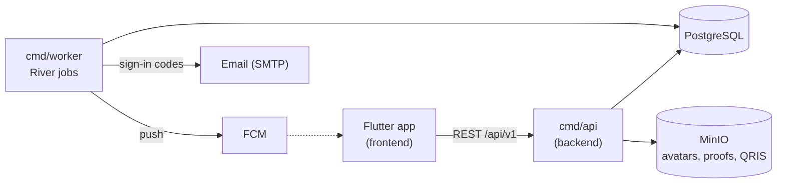

- The app caches groups, periods, payments and activity in a local Drift database and refreshes from the API (the server wins). Offline cash marks are queued and sent when the connection returns.
- Sign-in is by emailed code, with an optional PIN.
- Each draw publishes a seed hash when the period opens and reveals the seed at the draw, so anyone can recompute the winner. The app re-checks the draw on the device, and a public page at `/v/{code}` lets anyone verify it.

## Screenshots

| Launch | Onboarding 2 | Onboarding 3 | Login |
| --- | --- | --- | --- |
| 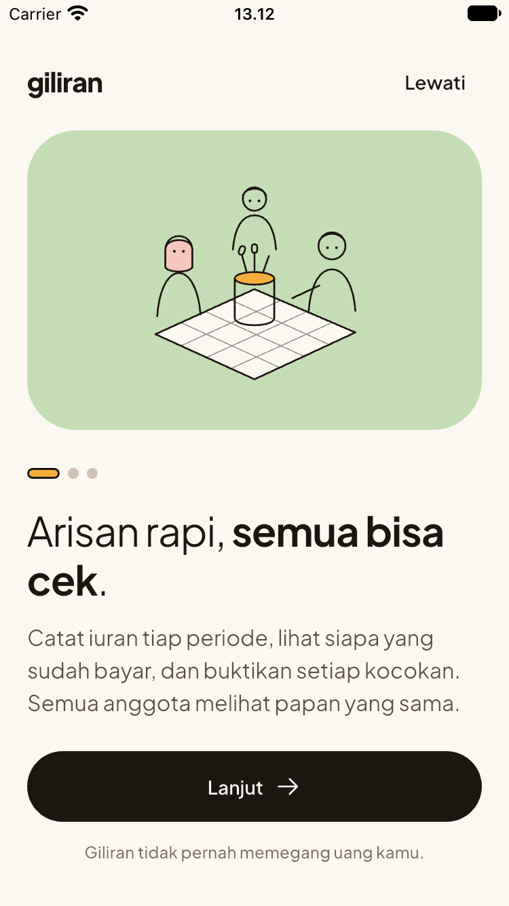 | 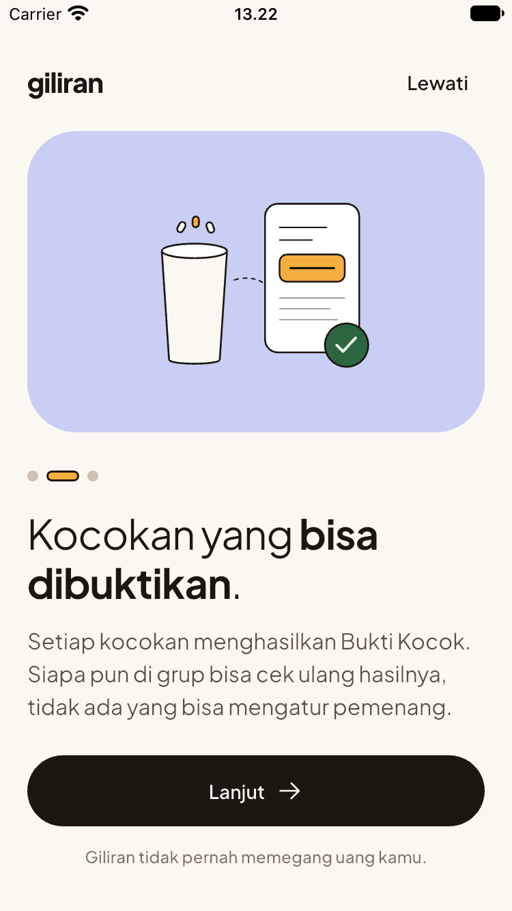 | 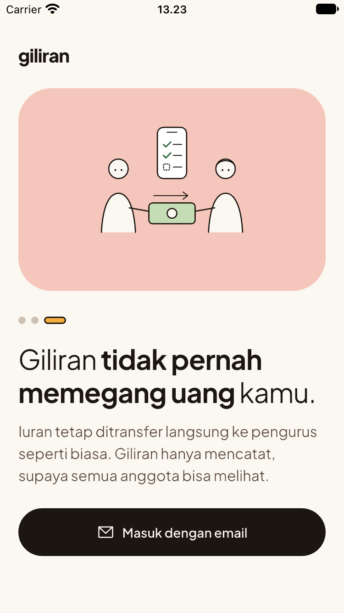 | 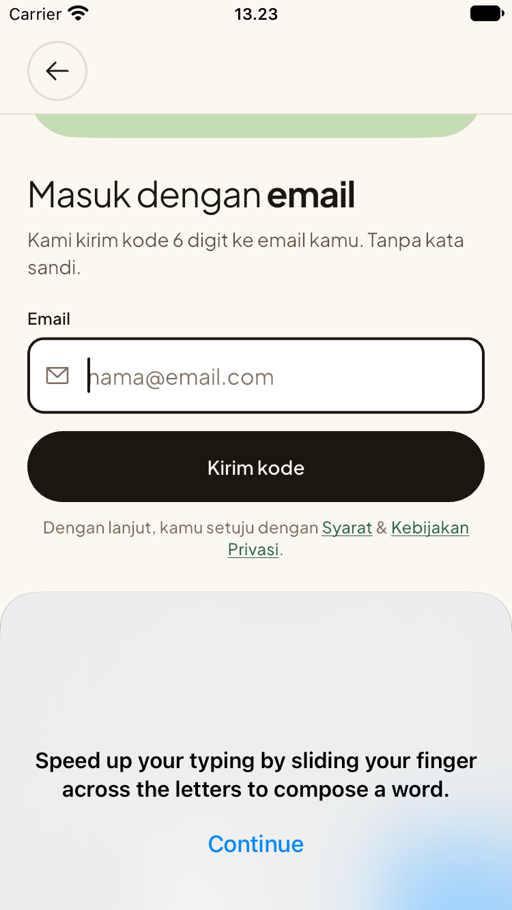 |

| Sign-in code | Profile setup | PIN | Home (empty) |
| --- | --- | --- | --- |
| 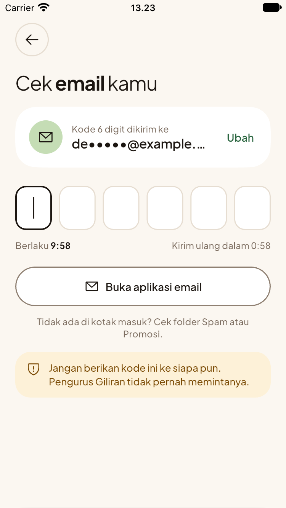 | 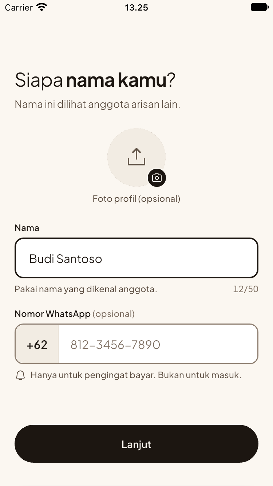 | 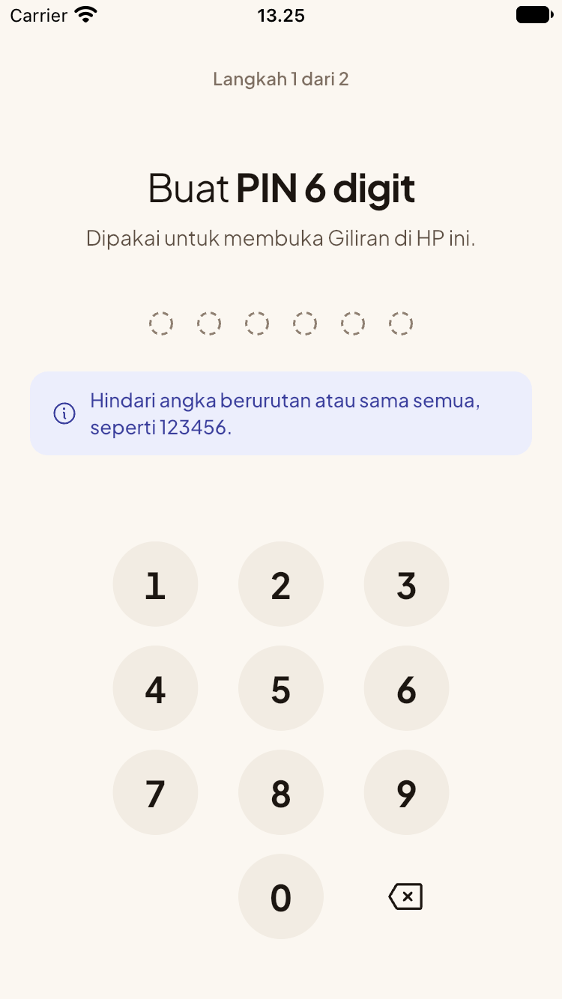 | 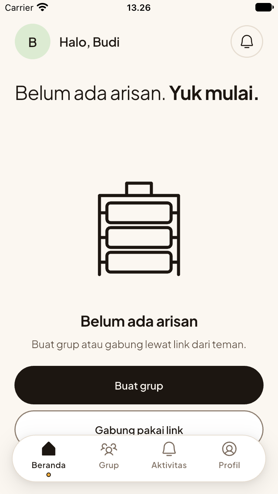 |

| Create group 1 | Create group 2 | Group detail | Home |
| --- | --- | --- | --- |
| 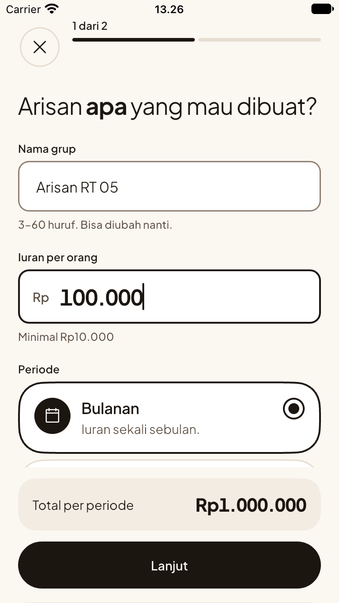 | 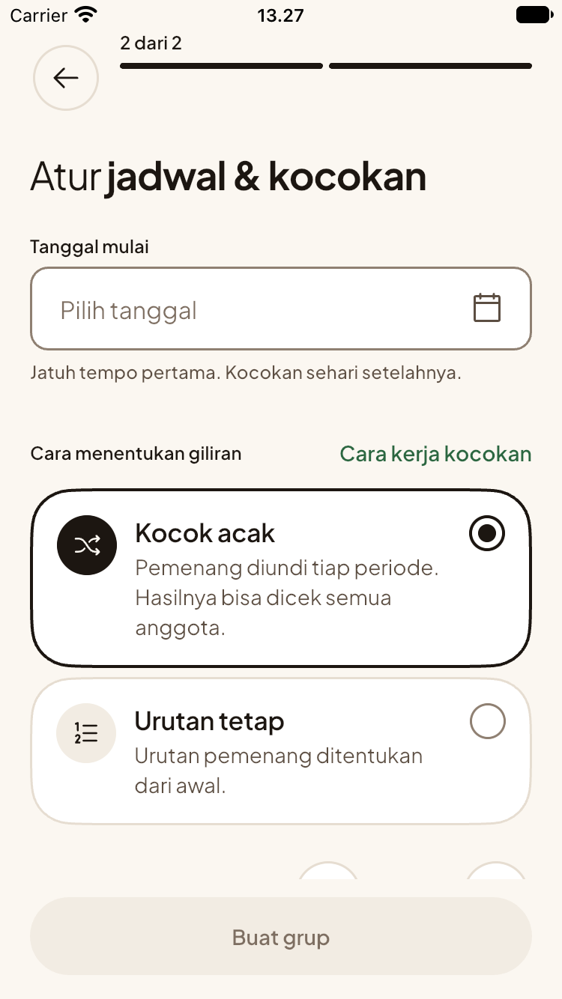 | 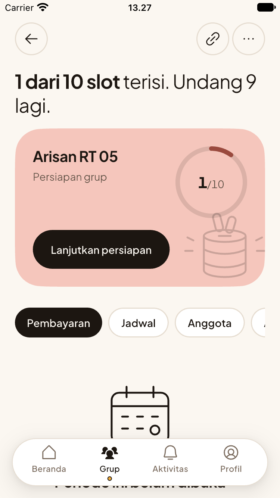 | 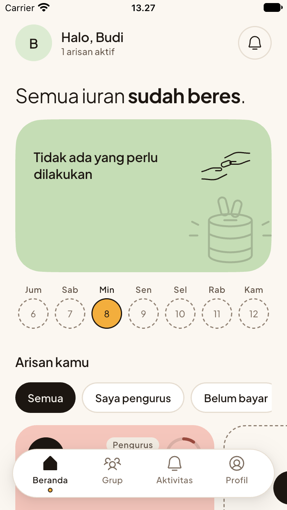 |

| Activity | Profile |
| --- | --- |
| 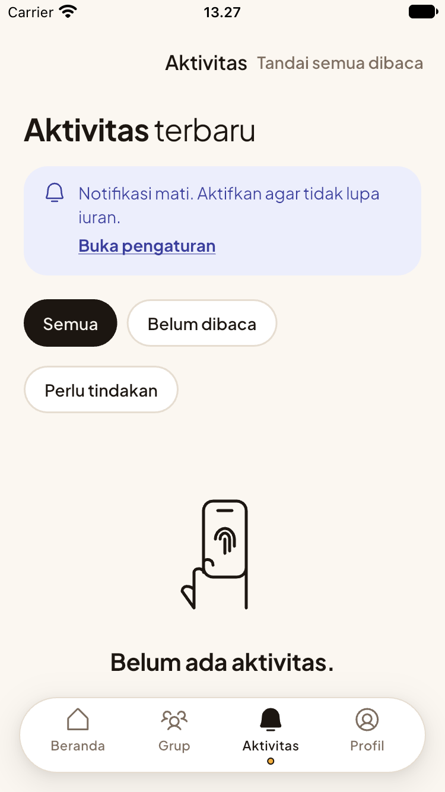 | 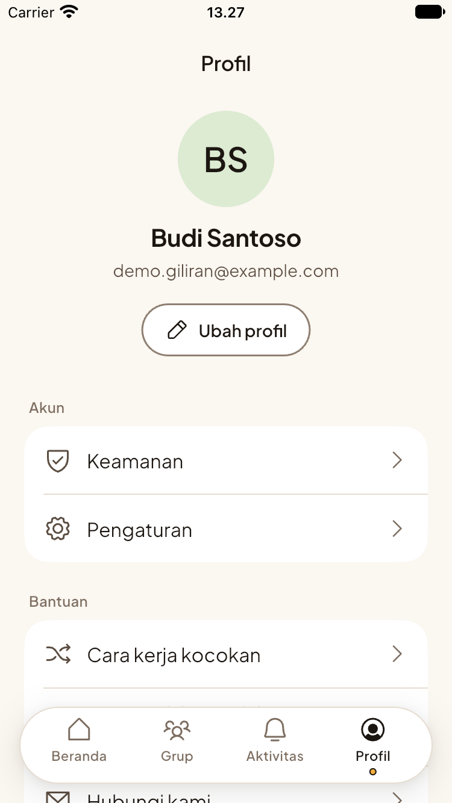 |

## Quick start

Run the backend, then point the app at it.

```sh
# 1. Backend (needs Go, Docker; see backend/README.md for the full list)
cd backend
cp .env.example .env        # fill in JWT_SECRET, OTP_SECRET and the CHANGE_ME values
make up                     # Postgres, MinIO, Mailpit, migrations, API and worker
curl localhost:8080/api/v1/health

# 2. App (needs Flutter and a Firebase config; see frontend/README.md)
cd ../frontend
flutter pub get
dart run build_runner build --delete-conflicting-outputs
flutter run --dart-define=API_BASE_URL=http://10.0.2.2:8080/api/v1   # Android emulator
```

In development the worker sends every email to Mailpit at <http://localhost:8025>, which is where sign-in codes show up.

## Documentation

| Topic | Where |
| --- | --- |
| Product requirements | [`backend/docs/PRD.md`](backend/docs/PRD.md), [`frontend/docs/PRD.md`](frontend/docs/PRD.md) |
| Database schema, state machines, draw algorithm | [`backend/docs/DB_SCHEME.md`](backend/docs/DB_SCHEME.md) |
| API contract (OpenAPI 3.1) | [`backend/api/api-spec.yaml`](backend/api/api-spec.yaml) |
| Design system ("Tikar") | [`frontend/docs/DESIGN_SYSTEM_V1.md`](frontend/docs/DESIGN_SYSTEM_V1.md) |
| Backend setup, config, tests, deploy | [`backend/README.md`](backend/README.md) |
| Frontend setup, structure, tests | [`frontend/README.md`](frontend/README.md) |

## CI

GitHub Actions in [`.github/workflows`](.github/workflows):

- `backend.yml`: lint, `sqlc diff`, unit and integration tests, and image builds.
- `frontend.yml`: format, analyze and test, plus a signed release App Bundle on pushes to `main`.

## Contributing notes

Each project has a `CLAUDE.md` with its conventions ([backend](backend/CLAUDE.md), [frontend](frontend/CLAUDE.md)). Generated Dart files (`*.g.dart`, `*.freezed.dart`, l10n output) and secrets (`.env`, Firebase config, keystores) are gitignored and must not be committed.
