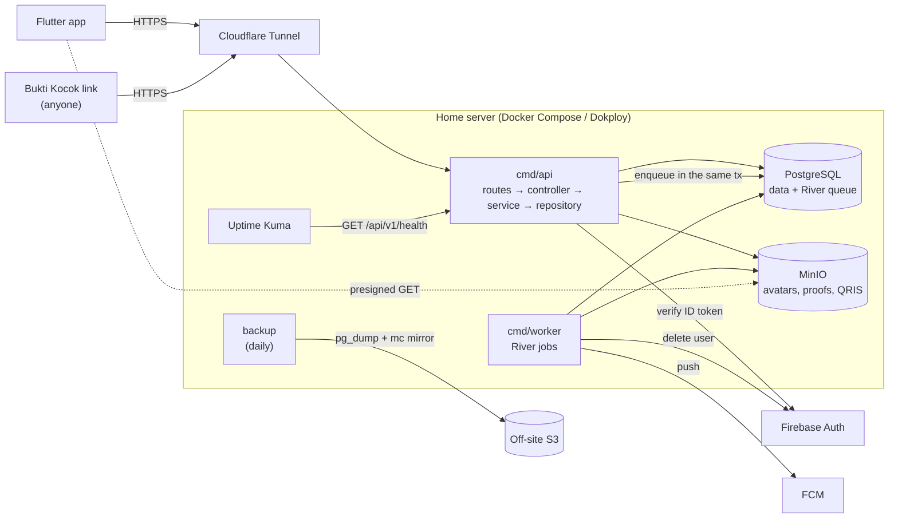

# Giliran backend

Giliran is a transparent arisan (rotating savings group) manager. An organizer runs a group of members who each pay a fixed share every period. The app records who paid, draws the period's winner with a verifiable commit-reveal draw, and records the payout. **It records money; it never moves it.**

This directory is the Go backend: a modular monolith with two binaries, `cmd/api` (Fiber HTTP API) and `cmd/worker` (River background jobs), on PostgreSQL and MinIO. The Flutter app lives in `../frontend`.

- Product spec: [`docs/PRD.md`](docs/PRD.md)
- Database schema, state machines and the draw algorithm: [`docs/DB_SCHEME.md`](docs/DB_SCHEME.md)
- API contract (OpenAPI 3.1, every endpoint and error code): [`api/api-spec.yaml`](api/api-spec.yaml)
- Build history and decisions: [`docs/IMPLEMENTATION_PLAN.md`](docs/IMPLEMENTATION_PLAN.md)

## Architecture



- **Request path:** `internal/routes` → `internal/controller` (HTTP only) → `internal/service` (business rules, transactions, authorization) → `internal/repository` (sqlc over pgx) → PostgreSQL. The layers are wired with Uber Fx, and each one has a `module.go`.
- **Group authorization** runs in the services on every request. A non-member gets `404 group_not_found`, and a member without the right role gets `403 forbidden_role`.
- **Money writes** (payments, draws, payouts, reminders) run in a transaction and require an `Idempotency-Key`. Every organizer write appends to the activity log in the same transaction, and database triggers keep the log and draw results immutable.
- **Jobs** (pushes, reminders, missed-payment alerts, transfer expiry, cleanup, account purge) are queued in the same transaction as the write that caused them, so they run only if it commits.
- **Draws** use `hmac-sha256-v1` commit-reveal. When a period opens, `seed_hash` is published; at the draw, the seed is revealed so anyone can recompute the winner. The public check is at `/v/{code}` (HTML) and `/api/v1/public/draws/{code}` (JSON).

## Quick start

Prerequisites: Go 1.27.3, Docker, and on PATH [`sqlc`](https://sqlc.dev) 1.31.1, [`golangci-lint`](https://golangci-lint.run) v2 and [`air`](https://github.com/air-verse/air) (live reload, optional).

```sh
cp .env.example .env            # then fill in JWT_SECRET (openssl rand -base64 48) and the CHANGE_ME values
# Firebase console > Project settings > Service accounts > Generate new private key:
cp ~/Downloads/<key>.json secrets/firebase-service-account.json

make up                         # Postgres, MinIO, migrations, bucket, API and worker
curl localhost:8080/api/v1/health
```

Keep `MINIO_ACCESS_KEY`/`MINIO_SECRET_KEY` equal to `MINIO_ROOT_USER`/`MINIO_ROOT_PASSWORD`. Otherwise every upload fails with a signature error.

To run the binaries on the host instead, start only the dependencies:

```sh
make deps-up                    # Postgres + MinIO, app and River migrations, bucket
make run                        # API (reads .env; environment variables override it)
make run-worker                 # worker
make dev                        # API with live reload
```

`make help` lists every target. Migrations live in `db/migrations` (golang-migrate):

```sh
make migrate-create name=add_x  # new pair
make migrate-up / make migrate-down
make gen                        # regenerate internal/repository/sqlc after editing db/queries; commit it
```

## Configuration

Everything is read by `pkg/config` (koanf) in this order: defaults, then `.env`, then the environment. The config is validated at startup. [`.env.example`](.env.example) lists the values without a default. Every other tunable (timeouts, pool sizes, rate limits, TTLs, worker crons, retention) has a default in `pkg/config/config.go` and can be overridden by setting its variable, for example `RATE_LIMIT_WRITE_MAX=120`.

## Tests

```sh
make test                       # unit tests, no Docker
make test-integration           # + integration tests (testcontainers Postgres/MinIO; needs Docker)
make lint                       # golangci-lint, including integration-tagged files
go test -tags integration ./internal/repository -run TestWithTx   # one test
```

- Integration tests call `integration.NewDB(t)`. Each test gets its own clone of a migrated template database, so tests run in parallel.
- Endpoint tests check every response against `api/api-spec.yaml` (`test/contract`).
- `cmd/api/authz_integration_test.go` runs the real Fx graph and calls every `/groups/{id}` route as a non-member, as a plain member and with an unknown group. It also fails if a group route has no authorization case, or if any response leaks SQL or Go internals.
- `internal/routes/routes_test.go` fails if a write route has no rate limiter.
- `internal/draw/testdata/golden.json` pins published draws. If those vectors fail, fix the code, never the vectors.

CI ([`.github/workflows/backend.yml`](../.github/workflows/backend.yml)) runs lint, `sqlc diff`, unit and integration tests, and builds the images on every push.

### Latency smoke test

PRD §10 targets p95 under 300 ms for reads and 600 ms for writes. To check them against a running stack:

```sh
make smoke                                          # against http://localhost:8080
make smoke ARGS="-base-url https://staging.example -users 20 -requests 10"
```

The tool reads `.env` (its `DATABASE_URL` and `JWT_SECRET` must match the server). It seeds accounts straight into Postgres and drives one started group with reads, profile writes, proof uploads and reminders. It prints p50/p95/p99 per endpoint, and exits 1 if a target is missed or any request returns a 5xx. It writes data, so it refuses `APP_ENV=production` without `-force`. Keep `-requests × 4` under `RATE_LIMIT_WRITE_MAX`.

## Production

`deploy/docker-compose.prod.yml` runs the whole stack on one host (Dokploy):

```sh
docker compose -f deploy/docker-compose.prod.yml up -d --build
```

- Only the API is published, on `127.0.0.1:8080`, for the Cloudflare Tunnel. Set `HTTP_TRUSTED_PROXIES` so rate limits see the client IP from `X-Forwarded-For`.
- Inside the Compose network, use `DATABASE_URL=…@postgres:5432/…` and `MINIO_ENDPOINT=minio:9000`.
- The app downloads files from presigned URLs signed for `MINIO_PUBLIC_URL`. Route that hostname (for example a second tunnel ingress) to `minio:9000` **without rewriting the Host header**.
- Set `APP_ENV=production` and `APP_PUBLIC_BASE_URL` (invite, claim and Bukti Kocok links). The Firebase key goes in `secrets/`, which is mounted read-only at `/secrets`.
- On every `up`, `migrate` (app schema) and `river-migrate` (River's tables) run before the API and the worker start.

### Backups

`deploy/backup` builds a small image with `pg_dump` and `mc`. One run:

1. dumps the database (`pg_dump -Fc`), checks that `pg_restore` can read the dump, and uploads it to `<bucket>/postgres/giliran-<UTC timestamp>.dump`
2. mirrors the MinIO bucket to `<bucket>/minio/` with `--remove`, so proofs and avatars purged under the retention rules disappear off-site too
3. deletes dumps older than `BACKUP_RETENTION_DAYS` (default 30)

Set `BACKUP_S3_URL`, `BACKUP_S3_ACCESS_KEY`, `BACKUP_S3_SECRET_KEY` and `BACKUP_S3_BUCKET` in `.env`. The remote can be any S3-compatible store off the home server (Cloudflare R2, Backblaze B2…), and the bucket must exist. Schedule the backup daily with host cron or a Dokploy schedule:

```cron
0 2 * * *  cd /srv/giliran/backend && docker compose -f deploy/docker-compose.prod.yml run --rm backup >> /var/log/giliran-backup.log 2>&1
```

**Restore:**

```sh
# 1. stop the writers
docker compose -f deploy/docker-compose.prod.yml stop api worker

# 2. fetch a dump and restore it into the running postgres container
mc alias set remote "$BACKUP_S3_URL" "$BACKUP_S3_ACCESS_KEY" "$BACKUP_S3_SECRET_KEY"
mc cp remote/$BACKUP_S3_BUCKET/postgres/giliran-<stamp>.dump .
docker compose -f deploy/docker-compose.prod.yml exec -T postgres \
  pg_restore --clean --if-exists --no-owner -U "$POSTGRES_USER" -d "$POSTGRES_DB" < giliran-<stamp>.dump

# 3. restore the objects (from a shell that can reach MinIO, e.g. the minio-init image)
mc alias set local http://minio:9000 "$MINIO_ROOT_USER" "$MINIO_ROOT_PASSWORD"
mc mirror --overwrite remote/$BACKUP_S3_BUCKET/minio local/$MINIO_BUCKET

# 4. start again (migrations re-run and are no-ops)
docker compose -f deploy/docker-compose.prod.yml up -d
```

Test a restore on a scratch machine now and then. A backup that has never been restored hasn't been proven to work.

### Monitoring

`GET /api/v1/health` pings the database. It returns `200 {"data":{"status":"ok"}}`, or `503 service_unavailable` (logged with its cause) when Postgres is unreachable. Uptime Kuma is in the prod Compose file behind a profile:

```sh
docker compose -f deploy/docker-compose.prod.yml --profile monitoring up -d uptime-kuma
```

Open it at `127.0.0.1:3001` (over Tailscale, like the Dokploy panel) and add two HTTP monitors:

- `http://api:8080/api/v1/health`, from inside the network
- `https://<public API host>/api/v1/health`, through the tunnel, which also catches tunnel and DNS failures

Set up a notification channel (Telegram, email…). Because Uptime Kuma runs on the same host, it can't report the host itself going down. Add an external free monitor on the public URL as well.

The API and the worker log JSON (`slog`) with `request_id`. Every 500 and 503 is logged with its cause, while the client only gets the problem code.

## Project layout

```
cmd/api            HTTP API (Fx + Fiber v3)
cmd/worker         River worker; `worker migrate` creates River's tables
internal/routes    URL → controller, middleware order, rate limits
internal/controller HTTP only: parse, call the service, respond; Idempotency middleware
internal/service   business rules, transactions, authorization (Authz), activity log
internal/repository pgx pool, TxManager, repositories over sqlc (internal/repository/sqlc)
internal/jobs      Enqueuer, workers, notification kinds and texts (jobs/notify)
internal/draw      pure commit-reveal draw (Commit, Pick, Verify) with golden vectors
internal/clients   Firebase (auth, FCM, user deletion), MinIO storage
internal/web       public draw verification page (html/template)
internal/model, dto domain types and typed errors; request/response shapes
pkg/               config, logger, middleware, response, security, validation, clock, utils, images, qris
db/                migrations and sqlc queries
api/api-spec.yaml  OpenAPI contract
test/              integration (testcontainers), contract (OpenAPI), smoke (latency)
deploy/            Dockerfiles, dev and prod Compose, backup image
```
